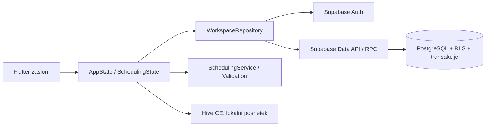
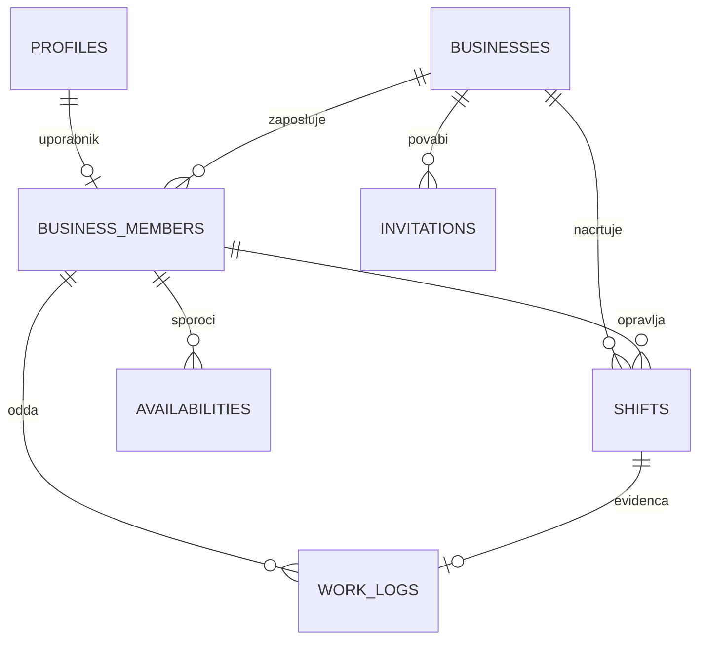

# ShiftMate Business

Mobilna aplikacija za mala podjetja, načrtovanje izmen, razpoložljivost in potrjevanje opravljenih ur. Projekt pri predmetu RVIR, UM FERI, 2026/2027. Samostojni razvijalec: Omar Zdralovic.

Implementacija prototipa je v repozitoriju. **Aplikacija je povezana z razvojnim Supabase projektom shiftMate.** Migraciji in RLS testi so uporabljeni oziroma preverjeni na dejanski bazi; Auth API se odziva. Za povezani zagon uporabi `flutter run --dart-define-from-file=config.local.json` ali VS Code konfiguracijo ShiftMate · Supabase. Podrobnosti: [povezava Supabase](docs/SUPABASE_CONNECTION.md). Celoten proces z dejanskimi prijavljenimi uporabniki še potrebuje preizkus. Podrobni rezultati in omejitve: [stanje prototipa](docs/PROTOTYPE_STATUS.md).

## Implementirane poti

- Supabase registracija, prijava, odjava in obnova seje prek SDK; validirani obrazci ter navigacija glede na članstvo v bazi.
- Ustanovitev podjetja; vabilo, vezano na potrjen e-poštni naslov, z enkratno kodo in veljavnostjo 7 dni. Delodajalec kodo posreduje ročno.
- Seznam zaposlenih, ime, delovna pozicija, urna postavka in omejitev tedenskih ur.
- Ustvarjanje, branje, urejanje in brisanje izmen; nočne izmene z izrecnim datumom konca.
- Vnos, urejanje in brisanje razpoložljivosti; pregled ekipe za delodajalca.
- Determinističen greedy razporejevalnik, pregled predloga, razlogi za nepokrite izmene, ročne spremembe in izrecna potrditev.
- Oddaja dejanskega intervala dela, odmora in opombe; statusi pending/approved/rejected; potrditev ali zavrnitev z razlogom samo za lastnika podjetja.
- Pregleda obeh vlog, obdobni seštevki in informativno plačilo iz potrjenih ur. Evidenca hrani postavko ob oddaji.
- Hive CE predpomnilnik zadnjih poslovnih podatkov, izoliran po projektu in uporabniku; gostota prikaza; brisanje osebnega predpomnilnika ob odjavi. Brez povezave je mogoče samo branje.

## Tehnologije in arhitektura

Flutter **3.47.7**, Dart **3.13.5**, Provider/ChangeNotifier, `supabase_flutter` **2.18.3**, PostgreSQL/RLS in Hive CE. Različice so razrešene v `pubspec.lock`. Uporabljena je stabilna veja Supabase 2.x; izdaja 3.x uvaja spremembe API. Ni lastnega backenda ali zunanjih AI storitev.



```text
lib/core/           tema
lib/models/         modeli in JSON pogodbe
lib/providers/      seja, nalaganje, napake in stanje predloga
lib/repositories/   podatkovni vmesnik in Supabase implementacija
lib/services/       razporejanje, validacija, statistika, lokalni predpomnilnik
lib/screens/        prijava, vključitev v podjetje, delovni zasloni in obrazci
lib/widgets/        skupni gradniki
supabase/migrations/ verzionirana shema, RLS, RPC in sprožilci
supabase/tests/     ločeni SQL preizkusi dostopa in atomarnosti
integration_test/  test poti prijava–urnik–odjava na napravi
```

Navigacijo lastnika sestavljajo Pregled, Urnik, Zaposleni, Delovne ure in Profil. Zaposleni vidi Pregled, Moje izmene, Na voljo, Delovne ure in Profil. Širši zasloni uporabljajo stransko navigacijo. Oblika sledi obstoječemu [Workforce Clarity](dokumentacija/mockupi/workforce_clarity/DESIGN.md), z modrim poudarkom, ravnimi površinami in besedilnimi statusi. Inter ni priložen, zato se uporablja sistemska pisava Flutter.

## Podatkovni model in varnost



Identiteta prihaja iz `auth.users`. En račun ima v prototipu eno članstvo oziroma podjetje. Vloga prihaja iz `business_members`, nikoli iz uporabniških metapodatkov. Lastnik se vzpostavi samo ob ustvarjanju lastnega podjetja. Vabilo vedno ustvari vlogo employee.

Vse javne tabele imajo RLS. Sestavljeni tuji ključi preprečujejo povezovanje vrstic med podjetji. Neposredni UPDATE evidenc ur ni dovoljen; pregled opravi preverjeni RPC. Interni privilegirani postopki so v neizpostavljeni shemi `private`, s fiksnim `search_path` in izrecnimi preverjanji identitete. Javne RPC funkcije so `SECURITY INVOKER`. Indeksi pokrivajo članstva, podjetja, časovne intervale in statuse.

Vsaka dodelitev na strežniku preveri pozicijo, razpoložljivost, počitek, prekrivanje in tedenske ure. Potrditev urnika zaklene podjetje, preveri različico vsake izmene in vse dodelitve shrani v eni transakciji. Izmene z evidenco so zaščitene pred spremembo intervala/dodelitve in izbrisom. Naknadna sprememba razpoložljivosti ne prekliče že objavljenih izmen; pred novimi dodelitvami se upošteva aktualno stanje.

## Konfiguracija in lokalni zagon

1. Namesti Flutter 3.47.7, Android SDK in JDK 17 ali združljiv JDK. Za lokalni Supabase potrebuješ Docker in Supabase CLI. Projekt nima lastnega strežnika Node.js.
2. Obstoječi razvojni projekt **shiftMate** ima referenco `vmayutnfvhqveztgtudu` in že uporabljeni migraciji. Za ta projekt začetne migracije ne izvajaj znova. Naslednja navodila veljajo tudi za pripravo drugega praznega razvojnega projekta; nepovezanih projektov ne spreminjaj.
3. Za novo prazno razvojno bazo uporabi [migracijo](supabase/migrations/20261127213651_prototype.sql): v Supabase SQL Editorju izvedi celotno datoteko ali z uradnim CLI najprej preveri `supabase link --help` in `supabase db push --help`, poveži pravi razvojni projekt ter uporabi migracije. Na obstoječi shemi najprej preglej konflikte. Skripta ne briše obstoječih tabel.
4. V Auth omogoči e-pošto/geslo in potrditev e-poštnega naslova. Nastavi ustrezni Site URL, kamor uporabnik prispe po potrditvi e-pošte. Po potrditvi se lahko ročno vrne v aplikacijo in prijavi; mobilni deep link za potrditev še ni implementiran.
5. V Data API izpostavi samo `public` (in privzeti `graphql_public`, če ga potrebuješ), **ne `private`**. Migracija dodeli pravice tabelam in RPC; omogoči API projekta.
6. Na tem računalniku je `config.local.json` že nastavljen za shiftMate. Na svežem klonu kopiraj `config.example.json` v prezrti `config.local.json` in vpiši URL ter javni publishable ključ. Obstoječi anon ključ je podprt prek `SUPABASE_ANON_KEY`. Nikoli ne uporabljaj `service_role` ali `sb_secret_` ključa v aplikaciji.

```bash
flutter pub get
flutter run --dart-define-from-file=config.local.json
```

Brez konfiguracije `flutter run` pokaže pojasnilo o manjkajoči povezavi. To ni način z lažnimi poslovnimi podatki. Registracija ne dodeli delodajalskih pravic; naslednji korak je ustanovitev lastnega podjetja ali sprejem vabila.

Za lokalni Supabase: zaženi Docker, nato `supabase start`. API in javni ključ pridobi iz lokalnega statusa. Na Android emulatorju je gostiteljski računalnik dosegljiv prek `10.0.2.2`, ne prek `localhost`. Produkcijska povezava naj uporablja HTTPS. Supabase konfiguracijo vedno preglej pred migracijami; datoteke `supabase/tests/auth_stub.sql` **nikoli ne izvajaj v Supabase projektu**.

## Auto-Scheduling Engine

`SchedulingService` je samostojna Dart storitev brez odvisnosti od UI in Supabase. Najprej razporeja težje pokrite izmene, nato čas in ID. Za vsako izmeno ponovno preveri kandidate ob upoštevanju začasnih dodelitev.

Obvezni pogoji: eno razpoložljivo okno mora pokrivati celotno izmeno; nobena nerazpoložljivost se ne sme prekrivati; pravilna pozicija in podjetje; brez prekrivanja; vsaj `businesses.min_rest_hours` počitka (privzeto 11); največ `max_weekly_hours`. Za tedensko omejitev se nočne izmene razdelijo čez **UTC ponedeljek 00:00**, enako v Dart in SQL. Časi se hranijo v UTC in prikazujejo v lokalnem času naprave. Obdobni izračun plačila izbere evidence po začetku intervala, ne deli posamezne evidence med obdobji.

Ocena kandidata: že dodeljene tedenske ure × utež porazdelitve + strošek nove izmene × utež stroška − preferenca × utež preference. `SchedulingWeights` omogoča konfiguracijo; privzete uteži so 1, 0,02 in 1. Izenačenje odloči stabilni ID zaposlenega. Preference so opcijski podatkovni atribut 0–10; UI jih za zdaj ne ureja.

Algoritem je hevristika in ne zagotavlja globalno optimalnega urnika. Neveljavne izmene ostanejo nedodeljene z razlogi. `SchedulingState` upravlja predlog in ponovno preverjanje pred potrditvijo; avtoritativna transakcija v bazi prepreči konflikte med pregledom in shranitvijo.

## Testiranje in gradnja

```bash
flutter pub get
dart format --output=none --set-exit-if-changed .
flutter analyze
flutter test --coverage
flutter build apk --debug
# APK z dejansko konfiguracijo:
flutter build apk --debug --dart-define-from-file=config.local.json
```

APK: `build/app/outputs/flutter-apk/app-debug.apk`. To je razvojni debug APK, ne izdaja za trgovino.

Unit/widget testi uporabljajo testni repozitorij, brez produkcijskih ključev. Preverjajo razporejevalnik, izračune, JSON, stanje seje, lokalno shranjevanje, obrazce, navigacijo in postavitve.

```bash
flutter test integration_test/session_test.dart -d <android-device-id>
flutter test test/layout_test.dart --dart-define=CAPTURE_VISUALS=true
```

Integracijski test na napravi uporablja testni repozitorij; **ne potrjuje omrežnega Supabase procesa**. Vizualni zajemi so v `build/visual/`; `FLUTTER_ROOT` mora kazati na uporabljeni SDK.

SQL preizkus na lokalni Supabase bazi po migraciji:

```bash
psql <local-development-connection> -v ON_ERROR_STOP=1 -f supabase/tests/rls.sql
```

Za običajni prazni PostgreSQL 17 najprej izvedi `supabase/tests/auth_stub.sql`, nato migracijo in `rls.sql`. Auth seam simulira `auth.uid()`, ne implementira Auth strežnika. Preverjanje vključuje dve podjetji, napačno e-pošto vabila, tuje zaposlene, evidence in izmene, dvig lastnih pravic, lastno potrjevanje ur, ponarejeno postavko, prekrivanje, zastarel predlog in transakcijsko povrnitev konfliktnega predloga. Testni podatki se povrnejo z `ROLLBACK`.

## GitHub Actions

Obstoječi workflow je razširjen za vsak `push`, `pull_request` in ročni zagon. Najprej PostgreSQL job preveri migracijo ter RLS z lokalnim Auth seamom. Nato Flutter job namesti zaklenjene odvisnosti, preveri format, analizo, teste s pokritostjo in zgradi APK. Artifacta vsebujeta pokritost in APK z datoteko `BUILD_STATUS.txt`, zadržana 14 dni.

V repository **Variables** ali **Secrets** nastavi obe vrednosti `SUPABASE_URL` in `SUPABASE_PUBLISHABLE_KEY`. Če obe manjkata, nastane jasno označena tehnična gradnja. Če manjka samo ena, gradnja namerno odpove. Fork PR nima dostopa do secrets in lahko zgradi tehnično različico. Vsi ključi, vključeni v APK, morajo biti javni publishable/anon ključi. Testi in analiza ne potrebujejo nobenega produkcijskega ključa.

## Demonstracija in omejitve

[Navodila za demonstracijo in status](docs/PROTOTYPE_STATUS.md) vključujejo pripravo petih računov in varni `supabase/demo.sql`. Obstoječa [prototipna dokumentacija](dokumentacija/prototipna_dokumentacija.md) vsebuje začetno zasnovo; ohranjena je tudi uporabnikova lokalna sprememba te datoteke.

Za naslednji mejnik: dejanska verifikacija ločenega Supabase projekta in celotne poti na napravi, obvestila, PDF/CSV, ponovna oddaja zavrnjene evidence, mobilne Auth povezave, upravljanje več podjetij in naprednejša pravila delovnega časa. Podatki se osvežijo na zahtevo; ni Realtime naročnin ali dvosmerne offline sinhronizacije. Predpomnilnik Hive ni šifriran in je namenjen prototipu v aplikacijskem zasebnem prostoru naprave. Velike organizacije potrebujejo tudi obdobne poizvedbe in skaliranje razporejanja.

Uradni viri, preverjeni pred integracijo: [Supabase Flutter](https://supabase.com/docs/reference/dart/initializing), [RLS](https://supabase.com/docs/guides/database/postgres/row-level-security), [supabase_flutter 2.18.3](https://pub.dev/packages/supabase_flutter/versions/2.18.3), [spremembe 3.x](https://supabase.com/changelog/supabase-flutter-v3).
