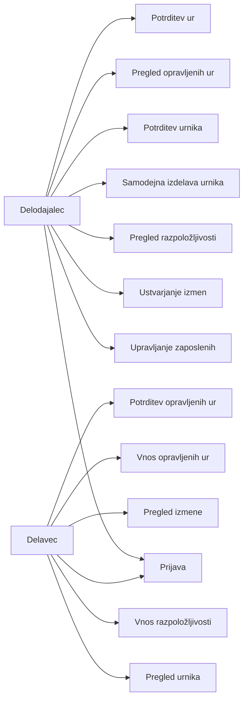
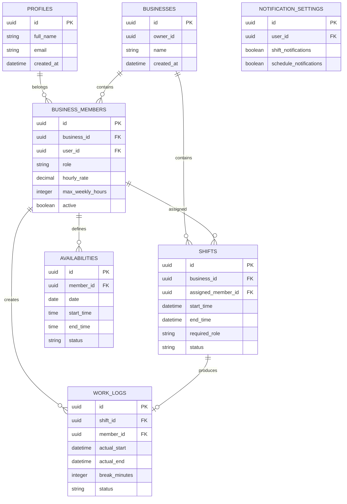
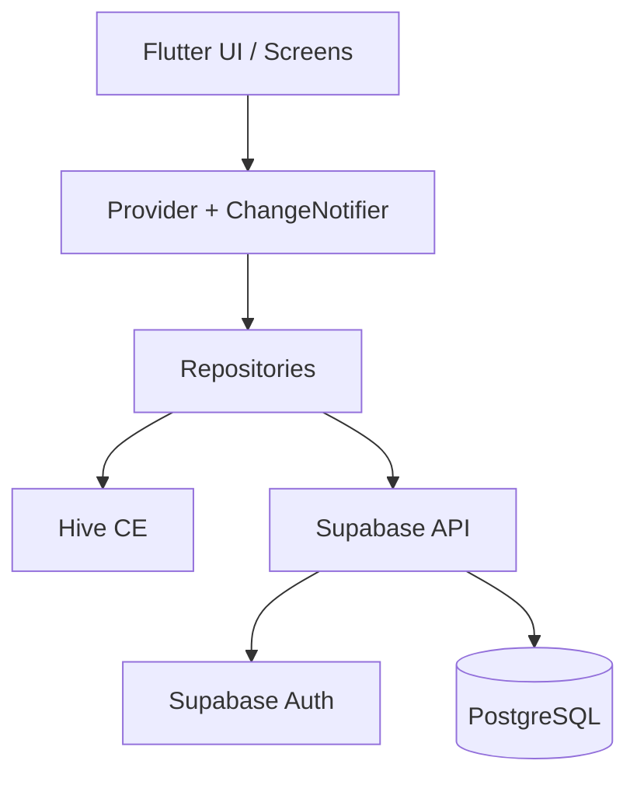

# ShiftMate Business
## Načrtovanje in prototipna dokumentacija

## 1. Opis projekta

**ShiftMate Business** je mobilna aplikacija za mala podjetja in njihove zaposlene, namenjena enostavnemu načrtovanju delovnih izmen, spremljanju razpoložljivosti zaposlenih ter evidentiranju in potrjevanju opravljenih ur.

Aplikacija rešuje problem organizacije dela v podjetjih, kjer se urniki pogosto pripravljajo ročno, preko sporočil, tabel ali drugih nepovezanih sistemov. ShiftMate Business želi proces združiti v eni mobilni aplikaciji.

V sistemu obstajata dve glavni uporabniški vlogi:

- **delodajalec**, ki upravlja zaposlene, izmene in delovne ure,
- **delavec**, ki pregleduje svoj urnik, vnaša razpoložljivost ter potrjuje opravljene ure.

Pomemben del aplikacije predstavlja tudi **Auto-Scheduling Engine**, ki na podlagi razpoložljivosti zaposlenih in določenih omejitev pripravi predlog urnika.

---

# 2. Glavne funkcionalnosti

## 2.1 Registracija in prijava

Uporabnik lahko:

- ustvari uporabniški račun,
- se prijavi,
- odjavi,
- obnovi prijavo ob ponovnem odprtju aplikacije.

Avtentikacija bo izvedena s storitvijo **Supabase Auth**.

---

## 2.2 Vloge uporabnikov

### Delodajalec

Delodajalec lahko:

- ustvari oziroma upravlja podjetje,
- dodaja zaposlene,
- določi podatke zaposlenih,
- določi urno postavko,
- določi največje dovoljeno število tedenskih ur,
- ustvarja izmene,
- dodeljuje zaposlene izmenam,
- pregleduje razpoložljivost zaposlenih,
- uporabi Auto-Scheduling Engine,
- pregleda opravljene ure,
- potrjuje oziroma popravlja delovne ure,
- spremlja osnovno statistiko.

### Delavec

Delavec lahko:

- pregleda prihodnje izmene,
- pregleda podrobnosti izmene,
- vnese svojo razpoložljivost,
- pregleda opravljene ure,
- vnese oziroma potrdi dejansko opravljene ure,
- prejema obvestila o novih ali spremenjenih izmenah.

---

# 3. Availability

Delavec lahko za posamezne dneve vnese svojo razpoložljivost.

Primer:

| Datum | Od | Do | Status |
|---|---|---|---|
| 23. 11. 2026 | 08:00 | 16:00 | Na voljo |
| 24. 11. 2026 | / | / | Ni na voljo |
| 25. 11. 2026 | 14:00 | 22:00 | Na voljo |

Razpoložljivost predstavlja enega izmed glavnih vhodnih podatkov za avtomatsko izdelavo urnika.

Delodajalec ima pregled nad razpoložljivostjo vseh zaposlenih.

---

# 4. Auto-Scheduling Engine

Auto-Scheduling Engine avtomatsko pripravi predlog razporeda zaposlenih na izmene.

Vhodni podatki algoritma so:

- seznam zaposlenih,
- razpoložljivost zaposlenih,
- zahtevane izmene,
- že dodeljene izmene,
- največje dovoljeno število ur,
- vloga oziroma usposobljenost zaposlenega,
- urna postavka oziroma strošek dela.

Uporabljen bo **hevristični constraint-based greedy algoritem**.

Algoritem najprej odstrani zaposlene, ki ne izpolnjujejo obveznih pogojev.

### Hard constraints

Zaposleni mora:

- biti na voljo v času izmene,
- ne sme že imeti druge izmene v istem času,
- ne sme preseči največjega števila dovoljenih ur,
- izpolnjevati zahteve izmene,
- imeti dovolj časa za počitek med izmenami.

### Soft constraints

Če je možnih več zaposlenih, algoritem upošteva:

- čim bolj enakomerno razporeditev ur,
- manjše trenutno število dodeljenih ur,
- preference zaposlenega,
- strošek dela,
- enakomerno razporeditev manj zaželenih izmen.

Po filtriranju kandidatov sistem izbere najprimernejšega zaposlenega.

Poenostavljen postopek:

```text
ZA vsako izmeno:

    poišči zaposlene, ki so na voljo

    odstrani zaposlene:
        - ki imajo prekrivajočo izmeno
        - ki bi presegli največ ur
        - ki nimajo zahtevane vloge
        - ki nimajo dovolj počitka

    kandidate razvrsti glede na:
        1. najmanj že dodeljenih ur
        2. preference
        3. strošek dela

    najboljšega kandidata dodeli izmeni

    če kandidata ni:
        označi izmeno kot nepokrito
```

Algoritem ne objavi urnika avtomatsko.

Delodajalec najprej dobi **predlog urnika**, ki ga lahko spremeni in šele nato potrdi.

---

# 5. Primeri uporabe

Glavna akterja sistema sta:

- Delodajalec
- Delavec



---

# 6. Ključni uporabniški scenariji

## Scenarij 1 – Delavec vnese razpoložljivost

1. Delavec se prijavi.
2. Odpre zavihek Razpoložljivost.
3. Izbere datum.
4. Določi čas, ko je na voljo.
5. Shrani razpoložljivost.
6. Podatek se shrani v Supabase.

---

## Scenarij 2 – Delodajalec ustvari izmeno

1. Delodajalec odpre urnik.
2. Izbere možnost Nova izmena.
3. Določi datum.
4. Določi začetni in končni čas.
5. Po potrebi določi zahteve izmene.
6. Izmeno shrani.
7. Izmena se pojavi v urniku.

---

## Scenarij 3 – Samodejno ustvarjanje urnika

1. Delodajalec ustvari potrebne izmene.
2. Delavci vnesejo svojo razpoložljivost.
3. Delodajalec izbere možnost Samodejno razporedi.
4. Sistem za vsako izmeno poišče primernega zaposlenega.
5. Sistem pripravi predlog urnika.
6. Nepokrite izmene so posebej označene.
7. Delodajalec pregleda predlog.
8. Predlog lahko ročno popravi.
9. Urnik potrdi in objavi.

---

## Scenarij 4 – Potrditev opravljenih ur

1. Delavec zaključi izmeno.
2. V aplikaciji vnese oziroma preveri dejanski čas dela.
3. Ure odda v potrditev.
4. Delodajalec prejme zahtevo.
5. Delodajalec ure potrdi ali popravi.
6. Potrjene ure se uporabijo za statistiko in obračun.

---

# 7. Predvidena navigacija

Po prijavi aplikacija glede na uporabniško vlogo prikaže različne možnosti.

## Delodajalec

```text
Dashboard
│
├── Urnik
│   ├── Nova izmena
│   ├── Podrobnosti izmene
│   └── Auto Schedule
│
├── Zaposleni
│   └── Podrobnosti zaposlenega
│
├── Razpoložljivost
│
├── Delovne ure
│
└── Profil / Nastavitve
```

## Delavec

```text
Domov
│
├── Moj urnik
│   └── Podrobnosti izmene
│
├── Razpoložljivost
│
├── Moje ure
│
└── Profil / Nastavitve
```

---

# 8. Mockupi

Za začetni prototip bodo pripravljeni naslednji najpomembnejši zasloni.

## 8.1 Login

Elementi:

- logotip ShiftMate Business,
- Email,
- Geslo,
- gumb Prijava,
- povezava Registracija.

---

## 8.2 Employer Dashboard

Prikazuje:

- današnje izmene,
- število zaposlenih,
- nepokrite izmene,
- čakajoče potrditve ur,
- bližnjico do urnika.

---

## 8.3 Schedule

Tedenski oziroma dnevni pogled na izmene.

Vsaka izmena prikazuje:

- čas,
- zaposlenega,
- status.

Omogočeno je:

- dodajanje izmene,
- urejanje izmene,
- ročno dodeljevanje,
- zagon Auto Schedule.

---

## 8.4 Availability

Koledarski pogled, kjer zaposleni za posamezen dan določi:

- na voljo,
- ni na voljo,
- časovno obdobje razpoložljivosti.

---

## 8.5 Auto Schedule Preview

Prikazuje avtomatsko pripravljen urnik.

Delodajalec lahko vidi:

- izmeno,
- predlaganega zaposlenega,
- nepokrite izmene,
- opozorila.

Na voljo sta gumba:

**Spremeni**

in

**Potrdi urnik**

---

## 8.6 Worker Dashboard

Delavec vidi:

- naslednjo izmeno,
- tedensko število ur,
- prihajajoče izmene,
- čakajoče potrditve.

---

## 8.7 Work Hours

Prikazuje:

- datum,
- načrtovane ure,
- dejanske ure,
- status.

Status je lahko:

```text
Osnutek
Oddano
Potrjeno
Popravljeno
```

---

# 9. Začetni podatkovni model

Glavne entitete sistema so:



---

# 10. Varnost podatkov

Za varovanje podatkov bo uporabljen **Supabase Row Level Security – RLS**.

RLS določa, katere vrstice v podatkovni bazi lahko posamezen uporabnik bere ali spreminja.

Primer:

Delavec lahko dostopa samo do:

- svojih izmen,
- svoje razpoložljivosti,
- svojih opravljenih ur.

Delodajalec lahko dostopa do podatkov zaposlenih, ki pripadajo njegovemu podjetju.

S tem je varnost uveljavljena na ravni podatkovne baze in ni odvisna samo od uporabniškega vmesnika aplikacije.

---

# 11. Arhitektura aplikacije

Aplikacija bo uporabljala večplastno arhitekturo.



### UI layer

Flutter zasloni in widgeti.

Njihova naloga je prikaz podatkov in uporabniška interakcija.

### State management

Uporabljen bo:

**Provider + ChangeNotifier**

ChangeNotifier hrani stanje posamezne funkcionalnosti.

Ko pride do spremembe, `notifyListeners()` obvesti widgete, ki se morajo ponovno izrisati.

### Repository layer

Repository predstavlja povezavo med aplikacijo in virom podatkov.

Primer:

```text
ScheduleScreen
      ↓
ScheduleProvider
      ↓
ShiftRepository
      ↓
Supabase / Hive
```

S tem uporabniški vmesnik ni neposredno povezan s podatkovno bazo.

---

# 12. Načrtovane tehnologije

| Področje | Tehnologija |
|---|---|
| Mobilna aplikacija | Flutter |
| Programski jezik | Dart |
| State management | Provider + ChangeNotifier |
| Backend storitev | Supabase |
| Podatkovna baza | PostgreSQL |
| Avtentikacija | Supabase Auth |
| Varnost | Supabase RLS |
| Lokalna baza | Hive CE |
| Obvestila | flutter_local_notifications |
| PDF | pdf / printing |
| CSV | csv |
| Testiranje | flutter_test |
| CI | GitHub Actions |
| Verzijski nadzor | Git / GitHub |

Za projekt ni predviden lasten Node.js backend. Flutter aplikacija komunicira neposredno s Supabase API.

---

# 13. GitHub struktura projekta

Predvidena začetna struktura:

```text
shiftmate-business/
│
├── .github/
│   └── workflows/
│       └── flutter-ci.yml
│
├── dokumentacija/
│   ├── prototipna-dokumentacija.md
│   ├── mockupi/
│   └── diagrami/
│
├── lib/
│   ├── models/
│   ├── providers/
│   ├── repositories/
│   ├── screens/
│   ├── services/
│   ├── widgets/
│   └── main.dart
│
├── test/
│
├── .gitignore
├── pubspec.yaml
└── README.md
```

---

# 14. Organizacija dela

Projekt se razvija samostojno, zato je isti razvijalec odgovoren za načrtovanje, implementacijo, podatkovno bazo, testiranje in dokumentacijo.

Razvoj bo razdeljen na več sklopov.

## Faza 1 – Inicializacija

- ustvarjanje Flutter projekta,
- GitHub repozitorij,
- začetna struktura,
- README,
- dokumentacija,
- GitHub Actions.

## Faza 2 – Avtentikacija

- Supabase povezava,
- registracija,
- prijava,
- uporabniški profil,
- vloge.

## Faza 3 – Osnovni podatkovni model

- podjetja,
- zaposleni,
- izmene,
- RLS pravila.

## Faza 4 – Upravljanje izmen

- ustvarjanje izmene,
- urejanje,
- brisanje,
- pregled urnika.

## Faza 5 – Availability

- vnos razpoložljivosti,
- prikaz razpoložljivosti,
- pregled za delodajalca.

## Faza 6 – Auto-Scheduling

- implementacija omejitev,
- iskanje kandidatov,
- točkovanje kandidatov,
- izdelava predloga urnika,
- prikaz opozoril.

## Faza 7 – Delovne ure

- beleženje opravljenih ur,
- oddaja,
- potrjevanje,
- popravljanje.

## Faza 8 – Dodatne funkcionalnosti

- statistika,
- obvestila,
- PDF/CSV,
- offline podpora.

## Faza 9 – Testiranje in zaključek

- unit testi,
- widget testi,
- odpravljanje napak,
- končna dokumentacija.

---

# 15. Začetni GitHub Issues

### Issue 1 – Initialize Flutter project

**Priority:** High  
**Assignee:** razvijalec

Vzpostaviti osnovni Flutter projekt in začetno strukturo map.

---

### Issue 2 – Configure GitHub Actions

**Priority:** High

Dodati workflow za:

- `flutter pub get`,
- `dart format`,
- `flutter analyze`,
- `flutter test`.

---

### Issue 3 – Create Supabase project

**Priority:** High

Vzpostaviti:

- PostgreSQL podatkovno bazo,
- Supabase Auth,
- začetne tabele.

---

### Issue 4 – Implement authentication

**Priority:** High

Implementirati:

- registracijo,
- prijavo,
- odjavo,
- session management.

---

### Issue 5 – Implement employee management

**Priority:** High

Omogočiti delodajalcu upravljanje zaposlenih.

---

### Issue 6 – Implement shift management

**Priority:** High

CRUD funkcionalnosti za izmene.

---

### Issue 7 – Implement employee availability

**Priority:** High

Omogočiti zaposlenim vnos in urejanje razpoložljivosti.

---

### Issue 8 – Implement Auto-Scheduling Engine

**Priority:** Medium

Izdelati algoritem za avtomatsko razporejanje zaposlenih.

---

### Issue 9 – Implement work-hour confirmation

**Priority:** Medium

Omogočiti oddajo in potrjevanje dejansko opravljenih ur.

---

### Issue 10 – Implement notifications

**Priority:** Low

Dodati obvestila o novih in spremenjenih izmenah.

---

### Issue 11 – Implement PDF/CSV reports

**Priority:** Low

Omogočiti izvoz podatkov.

---

### Issue 12 – Add offline support

**Priority:** Low

Dodati lokalno shranjevanje podatkov z uporabo Hive CE.

---

# 16. GitHub Actions

Začetni CI workflow se zažene ob vsakem:

- `push`,
- `pull_request`.

Workflow preveri:

1. ali se projekt uspešno namesti,
2. ali je koda pravilno formatirana,
3. ali Flutter analyzer zazna napake,
4. ali obstoječi testi uspešno prestanejo.

S tem že v začetni fazi zagotovimo osnovno avtomatsko preverjanje kakovosti kode.

---

# 17. Cilj prototipne faze

V prototipni fazi še ni potrebno implementirati celotne aplikacije.

Cilj je dokazati, da je projekt:

- dovolj natančno definiran,
- tehnično izvedljiv,
- arhitekturno načrtovan,
- razdeljen na razvojne naloge,
- pripravljen za nadaljnjo implementacijo.

Rezultat faze je GitHub repozitorij z začetnim Flutter projektom, prototipno dokumentacijo, mockupi, Issues in delujočim osnovnim CI workflowom.